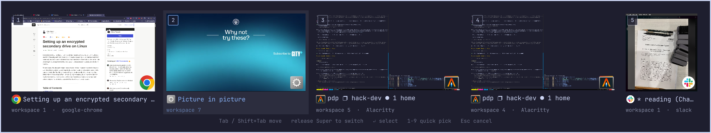

# alttab

A keyboard window switcher with live previews for Omarchy, built as an Omarchy shell plugin.

Hold `Super`, tap `Tab` to walk through your windows most-recent-first, release `Super` to switch.
Every window gets a live preview, its app icon, title, and workspace, across all monitors and
workspaces, so switching is by *window* rather than by workspace.

Features:

- Most-recently-used order, kept up to date from Hyprland events so the first `Tab` is always "the window I was just in"
- Live thumbnails through the Hyprland toplevel-export protocol (also for windows on other workspaces and monitors)
- `Shift+Tab` / arrows / `hjkl` to move, `1`–`9` to jump, `Enter` or mouse click to pick, `Esc` to cancel
- Appears on the monitor that has focus; follows the active Omarchy theme via the `[menu]` tokens
- Optional scope: every window, only this monitor, or only this workspace
- No process spawned per keypress: Hyprland delivers the shortcut to the shell as a Wayland global-shortcut event



## Requirements

- Omarchy 4.x (tested on 4.0.3 / Hyprland 0.56 / Quickshell 0.3.1)
- `jq` (ships with Omarchy); no sudo or pkexec is required

## Install

```sh
omarchy plugin add https://github.com/phiendp/alttab.git
~/.config/omarchy/plugins/io.github.phiendp.alttab/install.sh
```

The first command clones the plugin into the shell's plugin folder. The second enables it and
appends one line to `~/.config/hypr/bindings.lua` that loads `alttab.lua`, which:

- unbinds Omarchy's `SUPER+TAB` / `SUPER+SHIFT+TAB` (next / previous workspace);
  `SUPER+CTRL+TAB` (former workspace) is untouched
- binds `SUPER+TAB` and `SUPER+SHIFT+TAB` to the switcher
- binds the release of `Super` to "switch to the highlighted window"

Nothing else on the system is modified. Both scripts are idempotent.

To remove:

```sh
~/.config/omarchy/plugins/io.github.phiendp.alttab/uninstall.sh   # SUPER+TAB goes back to workspace cycling
omarchy plugin remove io.github.phiendp.alttab
```

## Configuration

Settings live on the plugin's entry in `~/.config/omarchy/shell.json` and hot-reload on save:

```jsonc
"plugins": [
  {
    "id": "io.github.phiendp.alttab",
    "scope": "all",           // all | monitor | workspace
    "includeSpecial": false,  // list windows on special (scratchpad) workspaces
    "liveThumbnails": true,   // false = one capture per window when the switcher opens
    "thumbnailHeight": 150,   // in Omarchy style units
    "showHints": true         // the key legend under the strip
  }
]
```

## How it works

```
SUPER+TAB ──► Hyprland bind ──► global dispatcher ──► omarchy-shell (GlobalShortcut "next")
                                                                │
                              ┌─────────────────────────────────┘
                              ▼
            overlay opens on the focused monitor, cursor on the 2nd most recent window
            each Tab moves the cursor; previews are ScreencopyView items on the windows' toplevels
                              │
   Super released ──► bindr SUPER_L ──► global "commit" ─┐
   (or the overlay sees the Meta key-up itself) ─────────┴──► hl.dsp.focus({ window = "address:0x…" })
```

The order comes from a most-recently-used list the overlay maintains from Hyprland's
`activewindowv2` / `closewindow` IPC events, seeded from `focusHistoryID` at startup. So the list is
ready the instant Tab is pressed, with no `hyprctl` round trip.

Focus goes through the Lua form of the dispatcher because Omarchy's Hyprland uses a Lua config and
parses every dispatch request as Lua; the classic `focuswindow address:…` string is a syntax error
there. This is the same call Omarchy's `omarchy-launch-or-focus` makes.

## Plugin anatomy

```
io.github.phiendp.alttab/
├── manifest.json     # id, kinds:["overlay"], entryPoints.overlay, keepLoaded (so the shortcuts register at startup)
├── Alttab.qml        # the overlay: PanelWindow on the Overlay layer, a strip of live previews, GlobalShortcuts
├── AlttabModel.js    # pure helpers (MRU ordering, scope filter, icon candidates, settings parsing)
├── alttab.lua        # the Hyprland bindings, loaded from ~/.config/hypr/bindings.lua
├── install.sh / uninstall.sh
└── README.md
```

Things learned on top of the [browserhat](https://github.com/phiendp/browserhat) notes:

**Global shortcuts.** `import Quickshell.Hyprland` gives `GlobalShortcut { appid; name; onPressed; onReleased }`.
Hyprland reaches it with `hl.dsp.global("appid:name")` (`bind = MODS, KEY, global, appid:name` in the
classic syntax). Hyprland sends both press and release for a global bind, and a `release = true`
bind on `SUPER + SUPER_L` fires when the Super key itself is let go. `hyprctl globalshortcuts` lists
what the shell has registered. Because the plugin registers its shortcuts, it must be `keepLoaded`.

**Live previews.** `ScreencopyView { captureSource: hyprlandToplevel.wayland; live: true }` from
`Quickshell.Wayland` renders a window, including ones on other workspaces. `sourceSize` gives the
real aspect ratio once `hasContent` is true. `Hyprland.toplevels.values` (from `Quickshell.Hyprland`)
provides address, title, workspace, monitor, the Wayland handle and the last `hyprctl clients` object.

**Icons.** `DesktopEntries.heuristicLookup(appId).icon` then `Quickshell.iconPath(name, true)`,
which returns an `image://icon/...` URL that goes straight into `Image.source`.

**Reloading code.** Saving a file under `~/.config/omarchy/plugins/` re-instantiates the plugin, but the
running QML engine keeps its compiled component and its directory listing, so edits to an already
loaded `.qml` do not show up until `omarchy restart shell` (which refuses to run while the session is
locked). New plugins load fine on first enable.

**Lua dispatch.** With Hyprland's Lua config, `hyprctl dispatch focuswindow address:0x…` fails with a Lua
parse error. Use `hyprctl dispatch 'hl.dsp.focus({ window = "address:0x…" })'`, and the same string
through Quickshell's `Hyprland.dispatch()`.

## Tooling

```sh
omarchy plugin validate ~/.config/omarchy/plugins/io.github.phiendp.alttab
omarchy-shell shell call io.github.phiendp.alttab debug ""             # current order, settings, screen
omarchy-shell shell call io.github.phiendp.alttab step 1               # open / move the cursor (also -1)
omarchy-shell shell call io.github.phiendp.alttab snapshot /tmp/a.png  # PNG of the card, how preview.png was made
omarchy-shell shell call io.github.phiendp.alttab commit ""            # switch to the highlighted window
omarchy-shell shell call io.github.phiendp.alttab cancel ""
hyprctl dispatch 'hl.dsp.global("io.github.phiendp.alttab:next")'    # what SUPER+TAB sends
```

## License

MIT, see [LICENSE](LICENSE).
